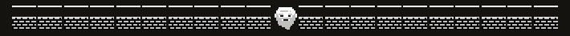

<p align="center">
  
</p>

<p align="center"><sub>Logo glyphs from <a href="https://i.imgur.com/SVAmWwD.png">Kruggsmash's tileset</a>; built by <code>assets/build-logo.py</code>.</sub></p>

<p align="center"><strong>An AI overseer that plays Dwarf Fortress on its own.</strong></p>

<p align="center">
  Urist sits between the game and the AI. It reads the fort's state, turns it
  into structured JSON and readable text, lets the AI act through an API,
  and reports events as they happen. The AI has no vision and no keystrokes:
  everything goes through the harness.
</p>

<p align="center"></p>

## 

Urist is a harness that lets any AI play Dwarf Fortress fortress mode. It
reads the fort's state, turns it into a form an AI can use, lets the AI act
through a clean API, and reports events as they happen: deaths, sieges,
strange moods, cancelled jobs, new arrivals.

It is AI-agnostic. Any model can drive it through the same protocol; nothing
depends on one model, its memory, or its tooling.

It is pinned to **Dwarf Fortress 0.47.05** with **DFHack 0.47.05-r8**. That
version is a deliberate choice, not a limitation.

## 

**M1 is done:** the AI played a full in-game day, built a still, and brewed
drink that completed and raised the fort's drink stock.

What is built, all verified against a live game:

- **Observation** — full fort state as structured JSON and readable text:
  dwarves, stocks, buildings, jobs, reports, map, designations.
- **Actions** — dig, chop, gather, build, manager orders, labors. Each
  action is checked before and after it runs.
- **Events** — a watcher inside the game fires on deaths, job completions,
  reports, invasions, and new arrivals, and streams them to the AI.
- **Planner and daemon** — a goal-driven planner and a daemon that owns the
  game loop, so the fort keeps playing tick after tick.
- **Diary** — one AI-written entry per in-game day (see below).
- **Placement and material awareness** — verified-free build sites, and
  exact have/need numbers for every job, read fresh from the game.
- **Dialog handling** — blocking modals are dismissed programmatically,
  never by keystrokes. A modal that asks the player to decide something —
  a trade, a meeting — is refused and named, never answered for the player.
- **Wiki lookup** — the AI can ask the Dwarf Fortress wiki during a run.
- **Embark** — seeded world generation to a verified fort
  (`scripts/embark.py`, `docs/EMBARK.md`).
- **Scoring** — a run is scored on survival, lives, wealth, needs, growth,
  competence, threats, plus milestones (`docs/SCORING.md`). Two 1-day runs
  are scored so far (91.8, 91.7); those are smoke runs, not benchmark
  results.
- **Supervisor** — systemd units bring the stack back after a reboot
  (`systemd/`, `scripts/install-supervisor.sh`). Kill-restart is verified;
  a full reboot has not happened yet.

What is not built yet: a fort that plays itself end to end with no
intervention. That is the goal. Trade, military, hospital, and the rest
of fortress mode are still to come.

## 

Four layers. Each layer is verified against a live game before the next is
built:

| Layer | What it does |
| --- | --- |
| **Observe** | Reads the game through DFHack RPC and returns the fort as JSON and readable text. Raw values are interpreted into plain state, stable lists are compressed to diffs, and what needs attention comes first. |
| **Act** | A typed action catalog. Every action names its parameters, legal values, preconditions, and expected effects, and verifies the result in the game. |
| **Events** | A watcher inside the game emits events as they happen. The AI is pinged instead of polling blindly, and the game pauses first on a threat. |
| **Plan** | A daemon drives the loop: observe, decide, act, verify, repeat. Goals are ordered by survival first, and every decision is journaled. |

The AI never touches the game directly. It has no vision and no keystrokes:
everything goes through the harness API.

## 

At the end of every in-game day, the AI writes one entry about the fort —
a story, not a list: what happened, who did it, how the dwarves are doing,
and what is left open.

- **Per-dwarf feed.** Every entry is built from a per-dwarf record: each
  dwarf's mood, stress, wounds, needs, job, and relationships, and what
  changed for them that day. The feed comes from the State Store's
  per-unit history, not from the AI's memory.
- **AI-written, not templated.** The entry is written by the model from the
  feed. No template renders a list of events.
- **Grounding.** Every claim in an entry traces to a recorded event,
  decision, or observation. The AI is not allowed to invent events, or to
  carry a claim forward from an old entry unless today's facts confirm it.
- **Continuity.** The feed carries the recent entries and a running list of
  open threads, so the story arcs across days instead of restarting.
- **Where it lives.** Entries are stored in `diary.md` in the daemon's state
  directory (`~/.config/df-agent-harness/diary.md`) — that file is the
  source of truth. `diary.html` next to it is a self-contained reader
  (Dwarf Fortress colours and pixel font, entry index by in-game date,
  click to read, previous/next day, jump to latest).

Status: the writer works, and entries are checked against the store and
the game. Grounding is still being hardened: the prompt needs sharpening
so the AI counts carefully instead of generalizing.

## 

- **AI-agnostic.** Any model, any provider. The protocol is the interface.
- **Everything through the API.** No screenshots, no simulated keystrokes for
  game actions.
- **Live-verified, or it does not count.** Every step is tested against a running
  fort before the next one is built. Offline tests alone never prove a feature.
- **The AI starts knowing nothing about Dwarf Fortress.** The harness teaches it:
  composed tasks that encode the game's causal chains, failure diagnoses that say
  what went wrong and how to fix it, briefings when a new situation appears, and
  a wiki it can ask.
- **The AI must remember what happened and why.** Events carry their causes,
  decisions carry their outcomes, and failures are recorded so the same mistake
  is not repeated.
- **Built for small context windows.** The harness pushes only diffs and a small
  snapshot each tick; the AI pulls full detail on demand. Nothing assumes a
  large context window.

## 

Requirements: Linux, Python 3.12, Dwarf Fortress 0.47.05, DFHack 0.47.05-r8,
and Xvfb. Full setup, with exact download URLs and checksums, is in
[docs/SETUP.md](docs/SETUP.md).

```sh
git clone https://github.com/nordicnode/urist.git
cd urist
python3 -m venv .venv
.venv/bin/pip install -r requirements.txt
```

Put a DF 0.47.05 install with DFHack r8 in `third_party/df_47_05/`
(see [docs/SETUP.md](docs/SETUP.md)), then:

```sh
# Observe the fort once
.venv/bin/python scripts/dfh-observe.py

# Start the daemon (HTTP API on 127.0.0.1:8765)
.venv/bin/python scripts/dfh.py start

# Check it
.venv/bin/python scripts/dfh.py status
```

## 

The daemon serves HTTP on `127.0.0.1:8765`:

- `GET /v1/health`, `/v1/state`, `/v1/snapshot`, `/v1/units`, `/v1/unit/{id}`,
  `/v1/buildings`, `/v1/jobs`, `/v1/items`, `/v1/reports`, `/v1/map`
- `GET /v1/catalog`, `/v1/attention`, `/v1/wealth`, `/v1/diary`,
  `/v1/slice`, `/v1/areas`, `/v1/column`, `/v1/survey`, `/v1/wiki`
- `GET /v1/events` — server-sent events, plus JSON
- `POST /v1/actions/{dig,chop,gather,build,deconstruct,stockpile,order,queue-job,labor,pause,...}`
- `GET /v1/journal`, `/v1/goals`, `/v1/tasks`

The per-tick snapshot is an index into the full state: it always names what
exists, with ids, and the AI pulls full detail for anything it needs.

## 

```
src/dfagent_harness/   the harness: observe, actions, events, planner,
                       daemon, server, assembler, store, diary, dwarves,
                       dialogs, materials, placement, sites, wiki
src/dfhack_rpc/        minimal DFHack RPC client (stdlib + protobuf)
src/dfagent_harness/lua/  Lua helpers run inside the game via DFHack
scripts/               CLIs: dfh (daemon), dfh-observe, dfh-act,
                       dfh-events, m1_driver, reload_fort, embark,
                       score_run, recover.sh, install-supervisor.sh
scripts/supervisor/    run_df.py — systemd wrapper: reload + watch one DF
systemd/               urist-*.service + urist-stack.target (boot supervisor)
docs/                  OBSERVE.md, ACTIONS.md, EVENTS.md, DAEMON.md,
                       PLANNER.md, PROTOCOL.md, ACCEPTANCE.md,
                       DIALOGS.md, ADVANCED_MECHANICS.md, EMBARK.md,
                       FARMING.md, SCORING.md, SETUP.md
tests/                 unit tests plus live tests against a running fort
third_party/df_47_05/  DF + DFHack install (gitignored)
third_party/downloads/ original tarballs (kept, never re-download)
saves-clean/           pristine clean-base save (gitignored, local only)
logs/                  M1 run logs (m1-*.jsonl)
```

## 

1. ~~Planner and daemon live on a real fort, keeping it alive through a full
   in-game day.~~ **Done (M1):** a full in-game day with a brew that completed
   and raised drink.
2. ~~Embark from a seeded world to a verified fort.~~ **Done:**
   `scripts/embark.py`, `docs/EMBARK.md`.
3. Scoring that benchmarks models on the same start save and tick budget.
   **Done for 1-day runs** (`docs/SCORING.md`); longer runs and more
   dimensions are queued.
4. A fort that plays itself for in-game years: threats, trade, strange moods,
   military, farming, and everything else fortress mode holds.
5. An MCP server over the same API, so a Freebuff agent gets Urist as native
   tools instead of shelling out to the CLI.

## 

Copy the block below and paste it to your AI. It will set up the whole
project for you. No further input from you is needed unless a step fails —
in that case the AI should say so plainly, not skip it.

```text
Set up the Urist project (https://github.com/nordicnode/urist) on this
machine, from scratch, and prove each step works before moving on. The
sources of truth are docs/SETUP.md in the repo and scripts/recover.sh.
If a step fails, say so plainly and stop — do not skip it, guess, or
work around it.

1. Clone the repo:
   git clone https://github.com/nordicnode/urist.git
   cd urist

2. Install Dwarf Fortress 0.47.05 and DFHack 0.47.05-r8, exactly as
   docs/SETUP.md says (do not use any other version):
   - Download df_47_05_linux.tar.bz2 from
     https://www.bay12games.com/dwarves/df_47_05_linux.tar.bz2
     (12,725,420 bytes, SHA-256
     ac74a6dbb7d7d9621f430405080322ab50c35f6632352ff2ea923f6dc5affca3).
     Verify the checksum before extracting.
   - Download dfhack-0.47.05-r8-Linux-64bit-gcc-7.tar.bz2 from the
     DFHack/dfhack GitHub release tagged 0.47.05-r8
     (18,139,358 bytes, SHA-256
     2eab7ca38a25eb15e6b2f1005a44968d58fae53f618ea9e4a31e1cd74d31926f).
     Verify the checksum before extracting. (Or use
     `gh release download 0.47.05-r8 --repo DFHack/dfhack --pattern
     'dfhack-0.47.05-r8-Linux-64bit-gcc-7.tar.bz2'`.)
   - Extract both into third_party/df_47_05/ with
     `tar --no-same-owner -xjf ...` (the tarballs store uid/gid 1000;
     plain tar fails on ownership). Remove the bundled
     libs/libstdc++.so.6 and libs/libgcc_s.so.1, and set
     [SOUND:NO] in data/init/init.txt. The full commands are in SETUP.md.

3. Install the system packages:
   sudo apt-get install -y xvfb x11-apps imagemagick xdotool \
     libsdl1.2debian libsdl-image1.2 libsdl-ttf2.0-0 libgtk2.0-0t64 \
     libglu1-mesa libgl1
   (scripts/recover.sh does this step too, and is the recovery route
   after a VM replacement.)

4. Create the Python virtual environment and install the requirements:
   python3 -m venv .venv
   .venv/bin/pip install -r requirements.txt
   Use .venv/bin/python for everything — never the system python3,
   which has no pytest and no protobuf.

5. Start the virtual display and launch the game (run the game in the
   background; it does not exit on its own):
   Xvfb :99 -screen 0 1024x768x24 >/tmp/xvfb99.log 2>&1 &
   cd third_party/df_47_05
   DISPLAY=:99 ./dfhack >logs/dfhack.log 2>&1 &
   Launch with ./dfhack, NEVER ./df (./df runs vanilla DF with no
   DFHack loaded). Wait for stderr.log in the DF directory to show
   "DFHack is ready" and "DFHack version 0.47.05-r8", then confirm
   TCP port 5000 is listening (the DFHack remote server) and run:
   ./dfhack-run lua 'print("PROBE-OK df="..dfhack.getDFVersion().." dfhack="..dfhack.getDFHackVersion())'
   It must print PROBE-OK df=v0.47.05 linux64 dfhack=0.47.05-r8.
   (For the supervised stack, which brings the game, the daemon, and
   Xvfb back after a reboot, run bash scripts/install-supervisor.sh
   instead of starting the pieces by hand — see the repo AGENTS.md.)

6. Get the Free Pi JWT (the M1 model route, DeepSeek V4.1 Flash):
   Start the GitHub device flow by POSTing to
   https://api.freepi.ai/auth/github/device (this endpoint is named in
   scripts/freepi_token_poll.py). It returns a user code and a session
   id. Show the user code to the user and have them enter it at
   https://github.com/login/device. Then poll POST
   https://api.freepi.ai/auth/token with {"session_id": "<the new
   session id>"} until it returns a token (see
   scripts/freepi_token_poll.py for the polling loop). Do NOT reuse
   the SESSION_ID hardcoded in that script — it belongs to a previous
   setup. Write the token to ~/.free-pi/agent/jwt.txt with mode 0600,
   then verify it with GET https://api.freepi.ai/me using
   Authorization: Bearer <token> — it must return HTTP 200 with a
   handle and a tier.

7. Start the daemon:
   .venv/bin/python scripts/dfh.py start
   It binds 127.0.0.1:8765 and needs the bearer token in
   ~/.config/df-agent-harness/token. Check it with:
   .venv/bin/python scripts/dfh.py status
   curl http://127.0.0.1:8765/v1/health
   (the health endpoint needs no auth; it must answer 200).

8. Run the smoke tests:
   .venv/bin/python scripts/rpc_smoke.py --host 127.0.0.1 --port 5000
   (must exit 0)
   .venv/bin/python -m pytest tests/ -q --ignore-glob='tests/*_live.py' -k "not TestBriefingsLive and not TestCatalogLive and not TestDiagnoseLive and not TestSitesLive and not TestTasksLive and not TestWikiLive"
   The offline tests must pass. The live tests need the game and the
   daemon running; if either is down they fail — say which ones failed
   and why, do not hide them.

9. Run an M1 day from the clean base:
   A clean base save is NOT in the repo — saves-clean/ is gitignored
   and holds a local-only copy. If there is no clean base here, say so
   and do this first: generate a world per docs/SETUP.md, embark with
   scripts/embark.py (docs/EMBARK.md) or manually through the game's
   own screens, save immediately after embarking, and copy that save
   to saves-clean/<region>-<date>-clean/ as the clean base. Never let
   the game play the backup folder directly — copy it into the save
   directory first, e.g.:
   rm -rf third_party/df_47_05/data/save/region2-00125-04-01
   cp -r saves-clean/region2-00125-04-01-clean \
     third_party/df_47_05/data/save/region2-00125-04-01
   (Remove the destination first: a bare cp -r into an existing save
   folder nests the copy inside it instead of replacing it, and the
   game then loads the old save. Adjust the names if the clean base is
   named differently). Then:
   .venv/bin/python scripts/reload_fort.py region2-00125-04-01 --exact
   Verify the game loads paused, on the clean base's date, with
   drink >= 10. Then:
   .venv/bin/python scripts/m1_driver.py
   The run must end with "day complete" and a diary entry in
   ~/.config/df-agent-harness/diary.md. Read the run log in logs/ and
   report any idle ticks, failed actions, or diary failures.

Verify every step as you go. Report failures plainly instead of
skipping them. When in doubt, read docs/SETUP.md and
scripts/recover.sh — they are the sources of truth for this setup.
```

## 

MIT. See [LICENSE](LICENSE).

## 

- [Dwarf Fortress](https://www.bay12games.com/dwarves/) — the game, by Bay 12 Games
- [DFHack](https://github.com/DFHack/dfhack) — the modding API this harness drives
- [Dwarf Fortress Wiki](https://dwarffortresswiki.org/) — the game's documentation
